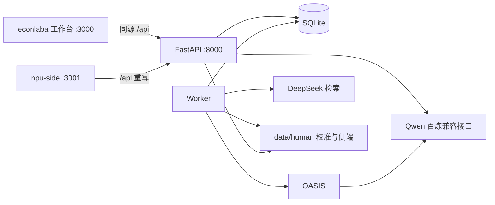

# EconLab

作者：何成浩、陈淇芮

本仓库以 MIT 协议发布，全文在 [LICENSE](LICENSE)。

本地单用户科研原型。研究者在浏览器里确认研究设计，独立 Worker 跑合成消费者实验，问卷、事件和指标留在本机，复现包也留在本机。当前案例是 2025 与 2026 年数码产品购新补贴。程序不预测销量，也不给出政策因果结论。

真人样本目前为零。工程夹具和合成仿真不能当作外部有效性认证。

研究协议、指标定义和已完成的验收记录在 [econlaba/README.md](econlaba/README.md)、[econlaba/docs/architecture.md](econlaba/docs/architecture.md)、[econlaba/PRODUCT.md](econlaba/PRODUCT.md)。

## 仓库怎么分

| 目录 | 现在干什么 |
|---|---|
| `econlaba` | API、Worker、原工作台、数据目录、安装脚本和 CI。检索、校准、侧端拟合都在这棵目录里。 |
| `npu-side` | 新的研究者界面，监听 `127.0.0.1:3001`，把 `/api` 转到同一套 API。 |
| `econlaba-search` | 检索并入 `econlaba` 之前留下的平行目录。里面没有 `side_infer.py`，启动脚本也不会拉起它。 |

`econlaba` 和 `econlaba-search` 都会占用 3000 与 8000。两份不要同时执行 `Start.ps1`。

## 代码在挡住什么

下面每条都对应已经写进仓库的行为。没写进代码的愿望不列在这里。

研究者改过并确认的计划才会进入队列。确认之后再改配置，要新建实验编号。失败的实验保留已经写出的文件，也可以导出。复现 ZIP 带问卷、事件和指标，也带后端代码快照与 SHA-256。解压后可以用 `python -m backend.recompute` 从这些文件再算一遍指标。

`live` 缺少 `DASHSCOPE_API_KEY` 时，Worker 直接报错，不会改跑 `smoke`。`live` 检索缺少 `DEEPSEEK_API_KEY` 时同样报错，不会用空的搜索结果假装已经搜过。`smoke` 不调用 Qwen，也不调用 DeepSeek。

政策知识和材料触达分栏记录，1 到 5 分的表达意向也分开。比较单位是条件乘以随机种子。程序不对互相影响的 Agent 做独立样本显著性检验。校准即使过了数值门槛，状态仍是待研究者审核，不会自动写成外部有效性认证。

每个实验在仿真前做一次检索。留下的命中和丢掉的命中一起写入 `search.json`，丢掉的条目带原因码。`decisions.json` 里的 `evidence_ids` 只指向留下的命中。`smoke` 把 `requested` 写成 false，两份列表都是空的。

校准导入停在本机，请求体上限 1MiB。材料哈希、问卷哈希或来源对不上就拒绝，并留下不含原始问卷的失败回执。`backend/calibration.py` 不把问卷发给 Qwen。

侧端发布会把三套映射转成 OpenVINO IR，再编译到设备名 `NPU`。可用设备里没有 `NPU` 时抛出 `InferenceRefused`，HTTP 503，响应文案是「旁侧推理未执行」，这次不写 `board.json`。`compile_for_test` 只接受 CPU，给测试用。拟合只用问卷里的 development 分割。heldout 只用来打分。验证实验时重新编译已经保存的 IR。只有这份实验就是协议的基线时，`matches_fit` 才比较两边的分数。其他实验该字段是 null。

模型请求在发出前预留额度。默认上限是 600 次 HTTP，以及 2,000,000 个预留 token。预留量等于请求体的 UTF-8 字节数，加上 `max_tokens`，再加 1024。超限后不再发新请求。失败或未知用量不退还。这个上限不是人民币账单。Worker 用文件锁保证同一数据目录只有一个实例。进程重新启动时，遗留的 `RUNNING` 和 `ANALYZING` 会被标成 `FAILED`，错误文案是「Worker 中断；已保留产物。请复制配置创建新实验重跑。」仍在 `QUEUED` 的任务还可以领取。半次仿真不会从中断处继续。

## 技术架构



浏览器不生成仿真结果，只轮询 API。API 做校验和入队。长任务在 Worker 里跑。`backend/simulation.py` 在 Worker 进程内 `import oasis`，API 启动时不加载这套依赖。

任务状态是 `CREATED`、`VALIDATED`、`QUEUED`、`RUNNING`、`ANALYZING`、`COMPLETED`。异常进入 `FAILED`。重复启动返回冲突。

| 进程 | 地址或入口 | 职责 |
|---|---|---|
| FastAPI | `127.0.0.1:8000` | 校验、入队、读取产物、校准和侧端接口 |
| Worker | `python -m backend.worker` | 领取队列、仿真、检索、评分、报告、护照 |
| 原工作台 | `127.0.0.1:3000` | `econlaba/frontend`，五个工作区 |
| npu-side | `127.0.0.1:3001` | 实验表单、对比、导出、关系图、仪表盘、导入 |

`npu-side/next.config.ts` 把 `/api/:path*` 转到 `ECONLAB_API_URL`。没设这个变量时，目标是 `http://127.0.0.1:8000`。

本地数据在 `econlaba/data/`。任务库是 `econlab.db`。每次实验一个目录 `runs/<实验 ID>/`。校准在 `human/<协议 ID>/`。侧端模型在该协议下的 `side/ols`、`side/ridge`、`side/mlp`，对照表是 `side/board.json`，验证结果是 `side/checks/<实验 ID>.json`。Worker 锁文件是 `worker.lock`。`Start.ps1` 的进程号和日志在 `econlaba/logs/`。

一次 `live` 实验的顺序是固定的。Worker 先按政策品类准备检索词，向 DeepSeek 要 10 条结果，经本地门禁写入 `search.json`，然后才跑 OASIS。仿真结束后，用后测意向生成 `decisions.json`。接着完成确定性评分和规则审查并写出 `report.md` 与护照。`smoke` 跳过网络检索，其余写文件的步骤仍在。

`docs/mirofish-delivery.md` 写的是后续契约。当前运行路径仍是 Worker 里的 OASIS。仓库里没有 `logs.jsonl`，也没有 `decision-export.json`。检索和决策已经落在 `search.json` 与 `decisions.json`。

已锁定并随 `Setup.ps1` 安装的组合以 `econlaba/requirements.lock.txt` 和 `econlaba/frontend/package-lock.json` 为准。OASIS 0.2.5 要求 Python 3.11。`npu-side` 使用 Next.js 16.4 与 React 19。`openvino==2026.4.1` 写在 `requirements.txt`，不在锁文件里。`Setup.ps1` 只同步锁文件，常规安装没有 OpenVINO。侧端函数在运行时才 `import openvino`。包没装上时，这个导入错误不会被 API 收成 503。

## 功能实现

### 两个界面

原工作台有五个区：研究设计、消费者画像、社会仿真、实验对比、研究护照。操作顺序和截图见 `econlaba/README.md`。

`npu-side` 的页面：

| 路径 | 做什么 |
|---|---|
| `/experiments` | 填写问题，选择 smoke 或 live、2025 或 2026 政策、社交或直接阅读、两组或四组，生成计划，确认后创建实验并入队 |
| `/experiments/[id]/compare` | 读取指标接口，展示 comparison、因子、逐次运行和定义 |
| `/experiments/[id]/export` | 下载该实验的复现 ZIP |
| `/experiments/[id]/graph` | 用人口和最多 500 条事件画关系图 |
| `/experiments/[id]/board` | 分栏读取状态、指标、触达和侧端。打开页面不拟合 |
| `/import` | 冻结校准协议，下载 JSON 模板，导入问卷 |

侧栏把当前实验编号记在 `sessionStorage`。没有选中实验时，对比、导出和关系图不可点，仪表盘也不可点。

### 实验设计

政策快照只有 `cn-digital-2026-v1` 和 `cn-digital-2025-v1`。A0 是同一份政策事实的段落。A1 把同样的事实按品类、门槛和规则分条。两组共享画像和初始网络，激活计划与种子也相同。

四组只和社交暴露一起用。B0、B1 在对应材料上加一次固定转发。四组都有同一个额外账号和相同的关注边，只有转发动作不同。该账号不计入消费者人数。

直接阅读只允许 A0 与 A1。前测之后把原材料放进每个消费者的记忆，再后测，不跑社交步进。投递不等于读懂。

`npu-side` 表单把人数限制在 10 到 60，轮次限制在 1 到 6，种子限制在 1 到 3 个互不重复的整数。激活比例和 temperature 在这个表单里固定为 0.5 和 0.7。API 的种子列表只要求至少一项，并且互不重复，每个值落在 0 到 2³²−1。API 还接受 0.2 到 1 的激活比例，以及大于 0、小于 2 的 temperature。直接阅读配四组会被 API 拒绝。

### 两种运行

| 项目 | `smoke` | `live` |
|---|---|---|
| Qwen | 不调用 | 规划、OASIS 行动、访谈、补充审查，产生费用 |
| DeepSeek | 不调用，`search.json` 的 `requested` 为 false | 仿真前检索一次。缺密钥则失败 |
| 社交动作 | OASIS 上的脚本动作 | OASIS 的模型行动 |
| 访谈 | 固定答案 | 结构化 JSON，字段和取值由程序校验 |
| 能说明什么 | 软件路径和导出是否走通 | 合成群体上的实验记录。不能推断真实购买 |

### 检索门禁

`live` 请求 `DEEPSEEK_BASE_URL` 下的 `/v1/tools/search`。没设这个变量时，基址是 `https://api.deepseek.com`。请求体只有 `query`、`count`（固定 10）和 `need_content: false`。政策标题不超过 128 字时附带 `ori_question`。`query` 由政策品类拼成，缺「购新补贴」时补上，长度必须在 1 到 128 字。

门禁不发网络请求。一条结果按下面的顺序丢掉：

| 原因码 | 条件 |
|---|---|
| `bad_url` | 不是 `http://` 或 `https://`，或者条目不是对象 |
| `empty_text` | 标题或摘要为空 |
| `low_score` | `rerank_score` 低于 1.5，或分数不是数字 |
| `off_topic` | 标题、摘要、片段都没有命中本实验的政策词 |
| `duplicate` | 同一链接已经留下分数更高或更早看到的一条 |

留下的条目用 URL 的 SHA-256 前 16 位做 `id`。

`decisions.json` 只收录后测。意向 1 和 2 记为 `reject`，3 记为 `wait`，4 和 5 记为 `buy`。每条后测共用同一份留下的 `evidence_ids`。没有留下的链接时，这个数组是空的。直接阅读的 `round` 记 0。社交实验记配置里的轮次。错误日志里如果出现环境中的密钥，会换成 `[REDACTED]`。

### 校准

协议必须绑定一次已经完成的直接阅读实验。来源是 `human` 时，还要确认有权在本机处理，并填写授权引用和同意版本。真人协议还要求这条基线是 `live`。导入文件在浏览器侧先卡 1MiB，服务端同样限制体积。标准化问卷只进入 `data/human/`。

来源为 `fixture` 时，侧端板上的外部有效性文字是「工程夹具，不是真人证据」。来源为 `human` 时是「待研究者审核，未自动认证」。

### 侧端拟合

三套映射都在 development 分割上拟合：

| id | 形式 |
|---|---|
| `ols` | 闭式 logit，penalty 为 0 |
| `ridge` | 闭式 logit，penalty 为 1.0 |
| `mlp` | 7 维输入，16 维 ReLU，6 维 Sigmoid。种子 42，30 个 epoch，在 CPU 上训练 |

输入 7 个数：条件（A0 为 0，A1 为 1）、五道知识题的对错、前测意向的缩放值。输出 6 个数：五道知识题的对错，以及后测意向的缩放值。development 里任一条件的完成人数低于协议的 `min_per_condition`（默认 10）时，接口返回 `INSUFFICIENT_SAMPLE`，不发布模型。

打分有两项。五道知识题用 Brier。意向用绝对误差。heldout 没有可用行时，这两项是 null。合成消费者按条件乘以种子汇总，对照的问卷来自协议基线实验的 `surveys.json`。

`npu-side` 仪表盘上，拟合按钮只在协议基线就是当前实验时出现。验证按钮要已经读到 `board.json`。503 和样本不足不会删掉磁盘上已有的 `board.json`。页面随后再 GET 一次。

发布时 `model.xml` 关闭 fp16 压缩，以便文件和刚跑过的 IR 一致。验证只编译这些已保存的文件，不重新拟合。

### 指标、预算和导出

主要指标有政策知识全对率和逐题正确率。另有触达或材料投递率、表达购买意向和意向的前后差。触达看的是 feed 里出现官方原帖或其直接转发。直接阅读的投递率看的是原材料投递事件。两者都不等于理解。表达意向不是购买。

预算账本在实验目录的 `budget.sqlite` 和 `budget.json`，并进入护照和 ZIP。独立的研究规划每次另计 1 个 HTTP 请求和 100,000 预留 token，不占用实验预算。工作台没有预算编辑框。API 可以把上限降到服务器默认值以下，不能再抬高。

导出不包含 `.env`。失败实验导出的是当时已经写下的文件。

## 部署

已经在 Windows 上走通的路径使用 PowerShell 7。命令用 `pwsh`。Windows PowerShell 5.1 跑不了这些脚本。

机器上需要 Git、Node.js 22.13 或更新版本，以及一个能执行 pip 的 Python。`Setup.ps1` 会在项目里安装 uv 和 Python 3.11，再建 `.venv`。不要把系统里的 Python 3.14 直接当成后端。首次安装要能上网。OASIS 的依赖包含 PyTorch，体积大。

```powershell
Set-Location c:\dev\break\econlaba
pwsh -File .\scripts\Setup.ps1
Copy-Item -LiteralPath .env.example -Destination .env
```

`.env` 的键：

```dotenv
DASHSCOPE_API_KEY=
QWEN_BASE_URL=https://dashscope.aliyuncs.com/compatible-mode/v1
QWEN_MODEL=qwen3.8-27b
QWEN_TIMEOUT=90
DEEPSEEK_API_KEY=
DEEPSEEK_BASE_URL=https://api.deepseek.com
```

`smoke` 可以空着两把密钥。`live` 要填自己的密钥。密钥只放在这台机器的 `.env` 或进程环境里。Git 里是空模板。浏览器和导出包不带密钥。模型 ID、接口地域和账号权限必须互相匹配。思考模式在请求里关掉，以配合当前的非流式预算计量。

```powershell
pwsh -File .\scripts\Start.ps1
```

启动后：

- 原工作台：http://127.0.0.1:3000/
- API 文档：http://127.0.0.1:8000/docs
- 健康检查：http://127.0.0.1:8000/health

`/health` 返回 `status`、`qwen_configured`、`oasis_version` 和 `model`。`Start.ps1` 在后台拉起 API、Worker 和原工作台，不打开新窗口。它不启动 `npu-side`。

新界面另开一个目录：

```powershell
Set-Location c:\dev\break\npu-side
npm ci
npm run dev
```

浏览器打开 http://127.0.0.1:3001/ ，会进到 `/experiments`。API 若不在本机 8000，启动前设置 `ECONLAB_API_URL`。

停止原工作台、API 和 Worker：

```powershell
Set-Location c:\dev\break\econlaba
pwsh -File .\scripts\Stop.ps1
```

`Stop.ps1` 只结束 `logs/processes.json` 里记录、且启动时间对得上的进程及其子进程。`npu-side` 的 `npm run dev` 不在这份记录里，要在那个终端自己停。改完 `.env` 后先停再起，进程不会热加载这份文件。

四个服务都只绑定回环地址，没有登录。不要把 3000、3001 或 8000 公布到公网。

`econlaba/compose.yaml` 可以把 API、Worker 和原工作台放进容器，端口仍映到 `127.0.0.1`，数据卷是 `./data`。容器构建和运行还没有验收。镜像按锁文件安装，里面没有 OpenVINO，compose 也没有把 NPU 设备传进去，并且不包含 `npu-side`。compose 文件在，不等于这些容器已经部署完成。

## 运维清单

按这个顺序看。前一项失败时，先处理前一项。

| 时机 | 做什么 | 对照 |
|---|---|---|
| 启动前 | 确认用的是 `pwsh`，不是 Windows PowerShell 5.1 | 脚本第一行要求 7.0 |
| 启动前 | 若已有 `econlaba/logs/processes.json`，先跑 `Stop.ps1` | 有这份文件时 `Start.ps1` 会拒绝启动 |
| 启动前 | 确认 8000 和 3000 没有监听。要用新界面时再看 3001 | `Start.ps1` 发现 8000 或 3000 被占用会退出 |
| 启动前 | `.venv\Scripts\python.exe` 和 `frontend\node_modules` 都在 | 缺了就先 `Setup.ps1` |
| 启动后 | 打开 `/health` | `status` 为 ok。要跑 live 时 `qwen_configured` 应为 true |
| 实验一直停在 `QUEUED` | 看 Worker 是否打印过 `EconLab Worker ready` | `logs/worker.err.log`、`logs/worker.out.log` |
| Qwen 返回 401、403、404 | 核对密钥、模型权限、地域 URL、模型 ID | 失败实验目录里的 `error.log` |
| live 在仿真前失败，文案提到 DeepSeek 或密钥 | 核对 `DEEPSEEK_API_KEY` 和 `DEEPSEEK_BASE_URL` | 成功写出的 `search.json` 里 `requested` 应为 true |
| 状态变成 `FAILED`，原因和预算有关 | 打开该实验的 `budget.json` | `stopped_reason`、`attempted_http_calls`、`reserved_tokens`。这不是账单 |
| Worker 被停掉或机器重启 | 把中断的运行标失败，保留产物，用复制配置新建实验 | 不要期待从中断的轮次接着算 |
| 改了 `.env` | `Stop.ps1` 之后再 `Start.ps1`。`npu-side` 若在跑，也重启 | 旧进程仍用启动时读到的环境 |
| 拟合侧端 | 先导入通过校验的问卷。当前实验必须是协议基线 | 按钮不出现时，看仪表盘上的基线是否匹配 |
| 拟合返回 503 | 本机 OpenVINO 的可用设备里要有 `NPU` | 没有 NPU 时不写新的 `board.json` |
| 拟合在导入 OpenVINO 处失败 | 锁文件没装这个包 | 版本钉在 `requirements.txt` 的 `openvino==2026.4.1`。`Setup.ps1` 不会安装它，这一步也没有随安装脚本验收 |
| 验证实验 | 实验状态是 `COMPLETED`，且 `side/<算法>/model.xml` 还在 | 验证编译的是这些文件，不会重新训练 |
| 备份 | 拷贝 `econlaba/data/`，里面有任务库、运行目录和 `human/` | 这些目录不进 Git。仓库没有单独的备份命令 |
| 密钥 | 不提交 `.env`，不把密钥打进 ZIP，不把真人原始问卷推进 Git | 错误日志里的密钥应已是 `[REDACTED]` |
| 改完后端或原工作台 | 在 `econlaba` 执行 `pwsh -File .\scripts\Check.ps1` | pytest、原前端的 typecheck 和 build。不构建 `npu-side` |
| 要连真实 OASIS 做工程闭环 | `pwsh -File .\scripts\Check.ps1 -Oasis` | 不产生远程 Qwen 调用 |
| 只改了 `npu-side` | 在该目录执行 `npm run build` | CI 工作流不覆盖这个目录 |
| 核对一份导出 | `.\.venv\Scripts\python.exe -m backend.recompute <导出目录>` | 在 `econlaba` 下执行 |

GitHub Actions 在 `econlaba/.github/workflows/ci.yml`。GitHub Actions 不配置模型密钥。只改 `docs/` 或 `README.md` 的推送会跳过重复验收。JUnit 和浏览器报告在 Actions 上保留 14 天。

## 现在还没有的

单 Worker 串行。没有取消按钮，没有检查点续跑，没有多用户登录，也没有公网鉴权。画像由规则生成，没有经过人口或行为校准。Docker 路径未验收。侧端要用的 OpenVINO 不在安装锁里，也没有 NPU 设备的部署验收。`docs/mirofish-delivery.md` 里的 MiroFish 网站和 Zep 不是当前运行路径，`logs.jsonl` 与 `decision-export.json` 也不是。真人样本为零。
